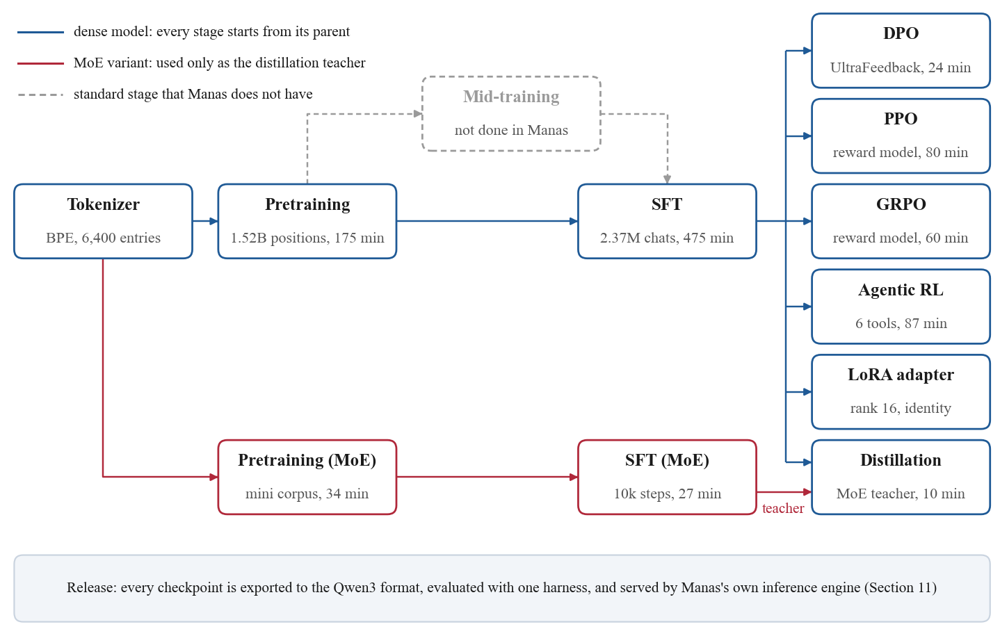
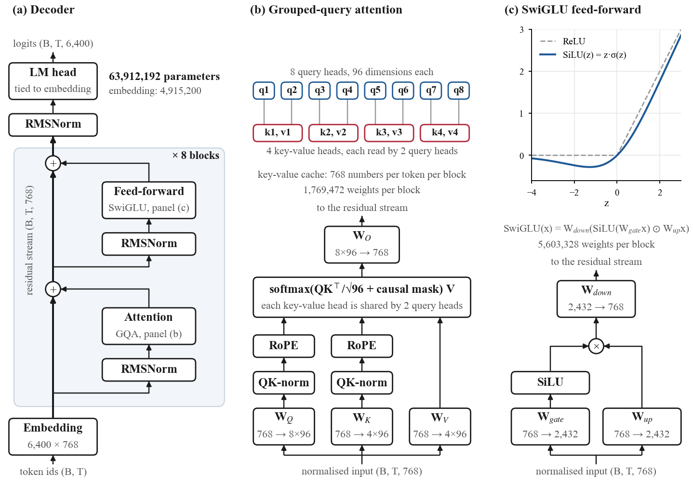
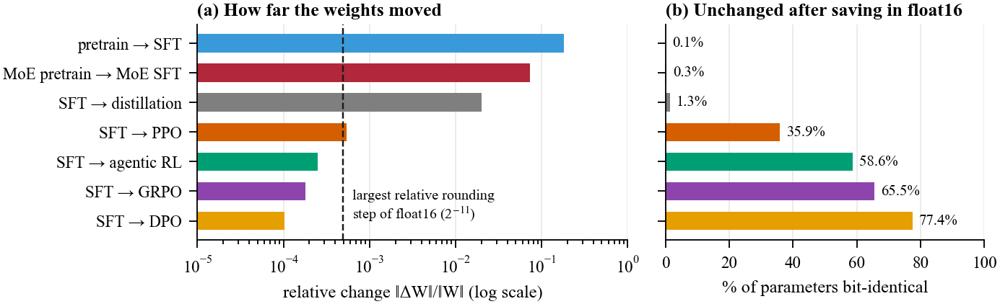

# Manas

Manas is a 64M-parameter language model built from scratch to show, in one small codebase, every stage of how a modern
language model is made: tokenizer, data pipeline, pretraining, supervised fine-tuning, DPO, PPO, GRPO, agentic RL with
tool calls, distillation, LoRA, and a mixture-of-experts variant. Each stage runs on one rented GPU in under eight hours,
every checkpoint loads as a standard Qwen3 model, and every stage is evaluated with the same code.

It is a reference for learning, not a capable assistant. At 64M parameters it scores near chance on knowledge
benchmarks.

| | |
|---|---|
| Technical report | [Manas-64M technical report (PDF)](https://github.com/kuluruvineeth/manas/releases/download/technical-report-v1/Manas-64M-technical-report.pdf) |
| Chat with every stage | [Manas-64M Space](https://huggingface.co/spaces/kuluruvineeth/manas-64m-chat) |
| Weights of every stage | [Manas-64M collection](https://huggingface.co/collections/kuluruvineeth/manas-64m-every-training-stage-6abf967eb1940477ad595a8e) |
| Training data | [`kuluruvineeth/manas_dataset`](https://huggingface.co/datasets/kuluruvineeth/manas_dataset) |
| Inference engine | [inference-engine](https://github.com/kuluruvineeth/inference-engine) |



## The model

768 wide, 8 layers, 63,912,192 parameters: grouped-query attention (8 query heads, 4 key-value heads) with QK-norm and
RoPE, a SwiGLU feed-forward network, and an output layer tied to the 6,400-entry embedding. The layer names match
Qwen3's, so an exported checkpoint is a plain `Qwen3ForCausalLM`:

```python
from transformers import AutoModelForCausalLM, AutoTokenizer

model = AutoModelForCausalLM.from_pretrained("kuluruvineeth/manas-64m-full-sft")
tokenizer = AutoTokenizer.from_pretrained("kuluruvineeth/manas-64m-full-sft")
```



The MoE variant replaces each feed-forward network with 4 experts and a top-1 router: 198M parameters in total, 64M
active per token.

## Stages

| Stage | Starts from | Trainer | Held-out loss | 5-benchmark average |
|---|---|---|---|---|
| pretrain | scratch | `trainer/train_pretrain.py` | 2.145 | 28.6% |
| full_sft | pretrain | `trainer/train_full_sft.py` | 1.375 | 28.0% |
| dpo | full_sft | `trainer/train_dpo.py` | | 28.0% |
| ppo | full_sft | `trainer/train_ppo.py` (reward model Skywork-Reward-V2-Qwen3-0.6B) | | 28.0% |
| grpo | full_sft | `trainer/train_grpo.py` (same reward model, group-relative advantages) | | 28.0% |
| agent | full_sft | `trainer/train_agent.py` (up to 3 tool-calling turns, answers checked) | | 28.0% |
| distillation | full_sft | `trainer/train_distillation.py` (MoE SFT model as teacher) | | 27.2% |
| pretrain_moe | scratch | `trainer/train_pretrain.py --use_moe 1` (mini corpus) | 2.772 | 26.8% |
| full_sft_moe | pretrain_moe | `trainer/train_full_sft.py --use_moe 1` | 2.181 | 25.8% |

Held-out losses are only comparable within a row: each stage measures a different quantity on a different split.
The benchmarks are ARC-Challenge, ARC-Easy, HellaSwag, MMLU and OpenBookQA, zero-shot, 500 items each; chance is 25%.

For scale, on the same 2,500 items and with the same scoring code, Pythia-70M averages 28.8% (trained on about 300B
tokens, against about 1.2B real tokens for Manas), GPT-2 30.7% and SmolLM2-135M 39.9%.

## What we found

Measuring each stage on the released checkpoints and logs turned up four problems that no loss curve showed:

- **DPO and RL barely moved the weights.** They changed the weights by 0.01 to 0.05% of their norm. After saving in
  float16, 77.4% of DPO's parameters are identical to the SFT model's, and DPO gives the same answer as SFT on 99.6% of
  benchmark items.
- **The MoE router never learned to route.** With top-1 routing and the selected weight renormalised to 1, the
  language-model loss sends the router almost no gradient (at most 3×10⁻⁸ per layer). Only the load-balancing loss
  trains it.
- **PPO and GRPO ignore the attention mask in the update.** On left-padded sequences, half of the importance ratios are
  already outside the clipping range before the first update.
- **Most of the corpus was never seen.** Documents are cut at 510 tokens instead of packed, so only 47% of the corpus's
  tokens were trained on.



## Train it yourself

```bash
uv sync
hf download kuluruvineeth/manas_dataset --repo-type dataset --local-dir dataset
uv run python trainer/train_pretrain.py
uv run python trainer/train_full_sft.py
uv run python trainer/train_grpo.py          # or dpo, ppo, agent, distillation, lora
uv run python scripts/evaluate.py
uv run python scripts/convert_model.py --stage full_sft --out_dir manas-64m-hf
```

Each trainer prints its options with `--help`. `gpu/` holds the Modal launchers used for the GPU runs.

## Layout

```text
manas/       model, training loops, data loaders, evals, serving, tools
trainer/     one entry point per stage
datapipe/    builds and publishes the dataset repo
scripts/     evaluate, chat, export, plot metrics, OpenAI-compatible server
deploy/      Docker, Kubernetes and Terraform for serving (see deploy/README.md)
demo/        Chainlit chat UI for any OpenAI-compatible endpoint
docs/        figures
tests/       247 tests: uv run pytest
```

## License

Apache-2.0
